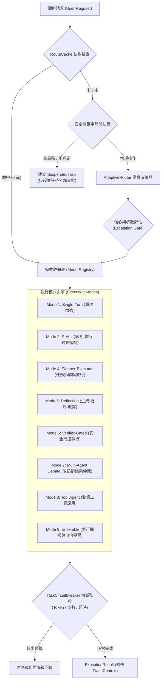

# Adaptive Agent Router: 架構設計白皮書與通用核心公版

## 1. 系統設計哲學 (Design Philosophy)

在生產環境的 LLM Agent 落地實踐中，單一代理架構（Monolithic Agent）必然面臨「成本、延遲、精確度與安全性」之間的不可調和衝突：
- 若對所有問題均採用高階多代理協作（Multi-Agent）或反思迴圈（ReAct），將導致簡單查詢產生不可接受的 Token 成本與秒級延遲。
- 若對複雜任務採用單次生成，則無法避免邏輯幻覺與上下文丟失。
- 若缺乏執行前門控，自由探索的 Agent 將對資料庫與外部 API 帶來不可逆的破壞性風險。

本專案提供一套工業級自適應動態調度中樞（Adaptive Agent Dispatcher）。透過前置輕量路由器（Router），在毫秒級時間內評估提問的語意維度、步驟深度與風險等級，動態將任務派發至十大標準設計模式（Design Patterns），並在執行鏈路中提供熔斷保護、非同步人機審批狀態機與分散式可觀測性。

---

## 2. 系統架構與狀態遷移 (State Machine Architecture)

系統核心由四層管線構成：快取與安全性快篩層、語意路由決策層、執行引擎層，以及邊界防護與遙測層。



---

## 3. 十大 Agent 設計模式分流矩陣 (Decision Matrix)

| 模式識別碼 | 架構模式名稱 | 決策特徵與觸發條件 | 延遲特徵 | 容錯與驗證策略 |
| :--- | :--- | :--- | :--- | :--- |
| `mode_1_single_turn` | 增強型單次回應 | 結構化資料抽取、單表欄位轉換、摘要、封閉式問答 | 最低 (< 1s) | 一次性推論，無重試機制 |
| `mode_2_react` | 反思迴圈 (ReAct) | 動態探索、日誌排查、多步追蹤、非固定路徑問題 | 中等 (1-3s) | 思考-行動-觀察三段迭代，上限預設 5 輪 |
| `mode_3_router` | 動態路由器 | 系統母體入口，負責意圖分類、複雜度與風險標記 | 極低 (< 200ms) | 精確雜湊快取 ➜ 靜態規則 ➜ 輕量 LLM |
| `mode_4_planner` | 規劃-執行器 | 跨模組長流程、架構設計、百萬級批次作業拆解 | 高 (3-8s) | DAG 依賴拆解，工作者並行執行後彙整校驗 |
| `mode_5_reflection` | 評估-優化反思 | 商業合約、法務合規、核心演算法優化、研究論文審查 | 高 (3-6s) | Generator ➜ Critic 挑刺 ➜ Optimizer 修正 (2-3 輪) |
| `mode_6_verifier_gated` | 驗證門控 | 包含 DELETE, DROP, 付款, 券商下單等不可逆指令 | 依審批而定 | 觸發 TaskSuspensionManager 掛起，需外部顯式授權 |
| `mode_7_multi_agent` | 對抗辯論協作 | 涉及跨領域權衡、架構決策評估、高爭議性方案論證 | 偏高 (3-5s) | 三權分立：正方立論 ➜ 紅隊挑刺 ➜ 首席仲裁者定案 |
| `mode_8_tool_use` | 工具使用代理 | 需動態挑選與組合外部 API、SQL、系統命令之通用場景 | 中等 (1-3s) | 動態 Schema 匹配與執行例外捕獲 |
| `mode_9_ensemble` | 並行自洽投票 | 複雜數學推演、邏輯定理驗證、極端低容錯情境 | 高 (多路並行) | 多路並行採樣後多數決 (Consensus Voting) |
| `mode_10_memory` | 情境式長期記憶 | 使用者偏好錨定、歷史決策繼承、跨階段狀態維持 | 低 (< 50ms) | 上下文注入前先檢索向量/語意快照 |

---

## 4. 關鍵防禦機制 (Guardrails & Resilience)

### 4.1 任務熔斷器 (TaskCircuitBreaker)
為防止 ReAct 模式或 Multi-Agent 對話陷入循環震盪，核心實例化每項任務獨立的生命週期守護者：
- **最大步數門檻**：單一任務上限預設為 8 步，超標即拋出 `CircuitBreakerException`。
- **Token 預算限制**：單一任務硬性上限 8,000 Tokens，防範惡意提示詞或迴圈燒乾配額。
- **超時限制**：30 秒非同步中斷保護。

### 4.2 非同步審批掛起機制 (Suspend & Resume State Machine)
針對微服務與 Web API 架構，高風險操作絕不採用本機阻塞式 `input()`：
1. 偵測到 `CRITICAL` 指令時，由 `TaskSuspensionManager` 序列化上下文並持久化，生成唯一的 `task_id`。
2. 系統向呼叫端回傳 `SUSPENDED` 狀態與審批憑證，立即釋放 Worker 執行緒。
3. 外部系統（如 Webhook、管理後台或 Slack 命令）呼叫 `dispatcher.resume_task(task_id, approved=True)`，載入快照並放行執行。

### 4.3 鏈路可觀測性 (Distributed Tracing)
遵循 OpenTelemetry 語意規範，為每次調用生成標準 `TraceContext`：
- 記錄 `trace_id`、`span_id`、各階段耗時與狀態。
- 透過 `ExecutionResult.metadata["trace"]` 導出標準結構化 JSON，可無縫對接 Datadog、Jaeger 或 ELK 日誌體系。

---

## 5. 模組引用與介面合約 (API Contract)

### 5.1 快速引入現有專案
在既有 Python 系統中，僅需 3 個步驟即可掛載本路由器：

```python
import sys
sys.path.append("/path/to/AdaptiveAgentRouter")

from router_app import AdaptiveAgentDispatcher, BaseTool

# 步驟 1: 實作專案自訂業務工具
class InvoiceOCRTool(BaseTool):
    name = "invoice_ocr_parser"
    description = "執行統一發票文字版面分析與欄位抽取"
    risk_level = "low"

    def execute(self, image_path: str = "", **kwargs):
        # 專案內部既有 OCR 呼叫
        return {"invoice_no": "AA-12345678", "amount": 5200}

# 步驟 2: 初始化調度器並註冊工具
dispatcher = AdaptiveAgentDispatcher(
    custom_tools=[InvoiceOCRTool()],
    enable_logging=True
)

# 步驟 3: 執行調度
result = dispatcher.process("請辨識發票 invoice_01.png 並結構化輸出")
print(result.output)
```

### 5.2 外部審批恢復範例
```python
# 1. 提交高風險請求
result = dispatcher.process("連線正式資料庫，清空 orders 測試表")

if result.metadata.get("status") == "SUSPENDED":
    task_id = result.metadata["task_id"]
    # ... 傳送至審批系統，等待管理員核准 ...

    # 2. 外部信號喚醒任務
    approved_result = dispatcher.resume_task(task_id, approved=True)
    print(approved_result.output)
```

---

## 6. 目錄結構與責任邊界

```text
AdaptiveAgentRouter/
├── README.md                      # 架構白皮書與技術規格書
├── requirements.txt               # 基礎依賴
├── .env.example                   # 環境變數與模型端點配置
├── router_app/                    # 核心函式庫
│   ├── types.py                   # 資料模型契約 (RoutingDecision, ExecutionResult)
│   ├── config.py                  # 系統環境參數
│   ├── router.py                  # 動態路由中樞 (規則快篩 + LLM 語意推論)
│   ├── dispatcher.py              # 調度總管 (統一對外介面與生命週期管理)
│   ├── cache/                     # 路由快取層 (LRU Hash Cache)
│   ├── tracing/                   # 鏈路追蹤層 (TraceContext, OpenTelemetry 格式)
│   ├── guardrails/                # 安全與防禦層 (CircuitBreaker, Suspension, Escalation)
│   ├── memory/                    # 情境式記憶層 (Contextual Memory)
│   ├── modes/                     # 十大 Agent 模式實作 (SingleTurn, ReAct, Planner...)
│   └── tools/                     # 工具抽象規範 (BaseTool, FunctionTool)
└── examples/                      # 整合驗證示範
    ├── quickstart.py              # 系統驗證整合測試
    ├── plug_into_ocr_example.py   # OCR 專案掛載示範
    └── plug_into_stock_example.py # 金融風控專案掛載示範
```
