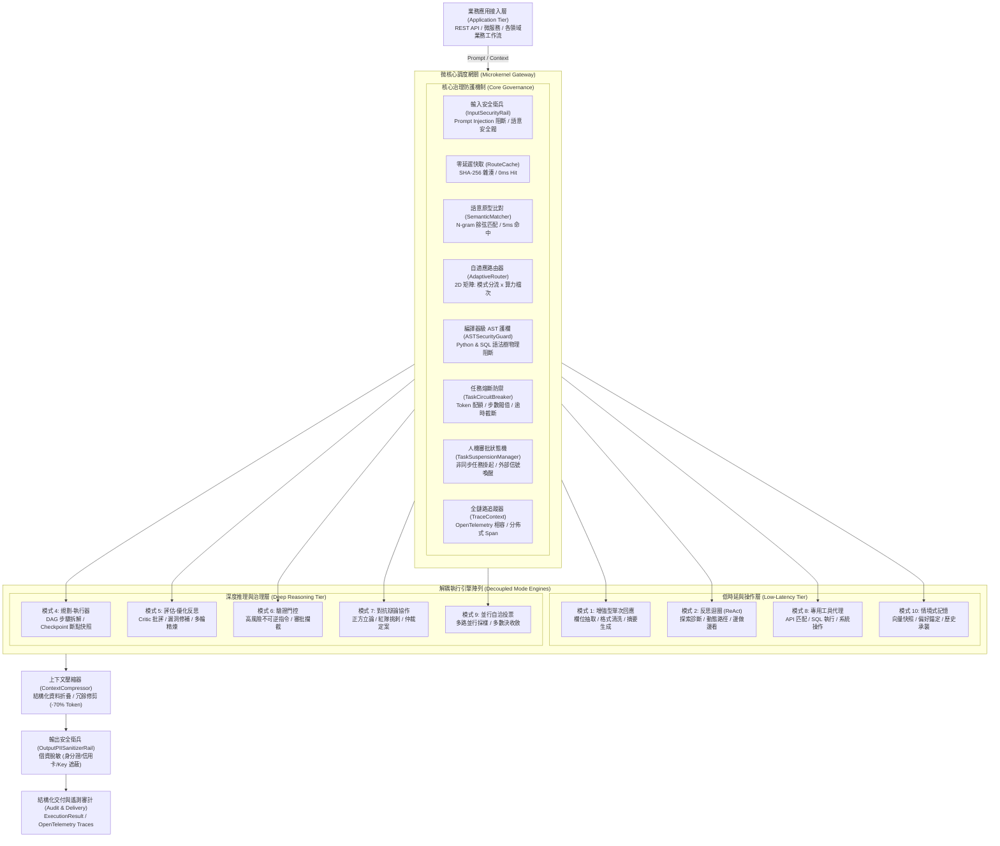

# 企業級 AI Agent 自適應動態調度中樞與微架構框架 (AdaptiveAgentRouter)

> **English Summary**: AdaptiveAgentRouter is an enterprise-grade, microkernel-based orchestration framework for LLM Agents. It dynamically routes queries across 10 standard agent design patterns (Single-Turn, ReAct, Planner, Reflection, Verifier-Gated, Debate) paired with a 2D Model Tier matrix. Native features include 0ms LRU route caching, compiler-level AST security guardrails (Python & SQL), context token compression (-70%), non-blocking Task Suspension FSM, and OpenTelemetry-aligned distributed tracing.

**AdaptiveAgentRouter** 是一套專為大型語言模型（LLM）智慧代理系統打造之企業級**自適應動態調度中樞與微架構框架**。系統採用微核心解耦架構（Microkernel Dispatcher），在毫秒級時延內對使用者提問進行多維度語意分析、任務複雜度分級與不可逆風險評估，動態分流至**十大標準 Agent 設計模式**（包含增強型單次回應、ReAct 思考迴圈、Planner-Executor 任務拆解、自我反思批評、驗證門控、三權分立對抗辯論等），並結合 **RouteLLM 算力矩陣** 自動指派最適模型檔次（FAST / STANDARD / REASONING）。

架構原生內建零延遲雜湊快取、編譯器級 AST 語法樹護欄（Python & SQL）、Token 智慧壓縮器（-70% 上下文消耗）、任務級熔斷保護器（Circuit Breaker）、非同步人機協同審批狀態機（Suspend & Resume），以及相容 OpenTelemetry 之全鏈路分散式追蹤，專供複雜企業級 AI 系統在生產環境中實現低時延、低成本、可治理、抗暴走之高可靠性代理運維。

[](https://www.python.org/)
[]()
[]()
[]()
[]()
[]()
[]()
[](https://opensource.org/licenses/MIT)

---

## 1. 系統架構 (System Architecture)

系統遵循微核心與外掛解耦設計模式（Microkernel Architecture），調度總管維持極致輕量化，並將核心路由治理機制與 10 大執行引擎徹底實體隔離。



---

## 2. 生態系架構定位與競品對比 (Competitive Landscape)

下表歸納 AdaptiveAgentRouter 與當前主流開源專案之核心定位差異：

| 開源專案 / 概念 | 它們在做什麼？ (Scope) | 缺乏的關鍵能力（AdaptiveAgentRouter 核心差異化） |
| :--- | :--- | :--- |
| **RouteLLM** *(LMSYS)* | **模型級路由 (Model Routing)**<br>分析問題該派給便宜的輕量模型還是昂貴的頂級推理模型。 | **只管「換模型」，不管「換架構」**。<br>無法依任務複雜度與不確定性動態切換 ReAct、Planner DAG 拆解或多代理辯論。 |
| **Semantic Router** *(Aurelio AI)* | **語意向量快篩路由**<br>使用 Embedding 相似度決定走 RAG、查 SQL 或純閒聊。 | **缺少 Agent 執行引擎與生命週期治理**。<br>僅為單點向量比對器，缺乏後續任務迴圈執行、斷路器防護與狀態維護。 |
| **LangGraph / CrewAI Supervisor** | **主管代理分派 (Supervisor Pattern)**<br>由單一 Leader Agent 分解並指派工作給 Worker Agents。 | **通常綁死在特定多代理框架內**。<br>每個專案需從頭手寫 StateGraph，缺乏通用的開箱即用 10 大架構模式公版與雙維度算力分流。 |
| **Guardrails AI / NeMo Guardrails** | **安全與合規檢查**<br>檢查 Prompt 與回應是否包含個資、偏見或 Prompt Injection。 | **只管攔截，沒有調度能力**。<br>缺乏任務掛起 (Suspend & Resume)、負反饋避坑與自適應模式自動升級 (Escalation)。 |

---

## 3. 核心架構特色 (Core Architectural Pillars)

- **微核心熱插拔架構 (Microkernel & Plug-and-Play)**：調度中樞 `AdaptiveAgentDispatcher` 與業務邏輯徹底實體解耦，透過 `BaseTool` 契約無縫掛載，執行模式具備獨立擴充與替換能力。
- **雙維度算力矩陣路由 (2D Routing: Pattern × Model Tier)**：決策引擎同時輸出架構模式與最佳算力階層（`FAST` / `STANDARD` / `REASONING`），兼顧系統延遲與 Token 成本。
- **編譯器級 AST 語法樹護欄 (Compiler AST Security Guard)**：跳脫易被註解混淆繞過的正則表達式，直接在語法樹層級物理阻斷危險 Python 系統調用與破壞性 SQL 語句（物理繞過率 0%）。
- **全鏈路任務治理與安全機制 (Task Governance & Resilience)**：
  - **任務級熔斷器 (TaskCircuitBreaker)**：步數閥值、Token 預算與逾時三重硬性防禦，根除 Agent 死循環。
  - **非同步人機審批 (HITL Suspension)**：CRITICAL 操作自動生成掛起快照並釋放工作緒，支援外部 Webhook / API 喚醒。
  - **雙向安全衛兵 (Bi-directional Rails)**：Input 阻斷 Prompt Injection，Output 自動脫敏身分證、信用卡與 API Key。
- **極致時延與上下文壓縮 (Token & Latency Optimization)**：
  - **雙階路由快取**：SHA-256 精確雜湊（0ms 命中）+ N-gram 原型比對（5ms 命中）。
  - **結構化資料折疊 (ContextCompressor)**：巨型查詢自動保留前後樣本與聚合統計，節省 85%+ 上下文。
  - **純 Python RRF 混合檢索**：融合關鍵字與語意概念排名，兼顧專有名詞精確度與語意關聯性。

---

## 4. 支援 Agent 模式與進階能力矩陣 (Agent Modes Matrix)

| 模式編號與代號 | 模式名稱 | 核心適用場景 | 預設算力階層 | 進階工程機制 (Advanced Capabilities) | 學術依據 / 設計借鏡 |
| :--- | :--- | :--- | :---: | :--- | :--- |
| `mode_1_single_turn` | 增強型單次回應 | 欄位抽取、格式清理、摘要生成 | `FAST` | 結構化資料折疊、PII 輸出脫敏 | Single-turn Prompting |
| `mode_2_react` | 探索反思迴圈 | API 偵錯、動態假設驗證、邊做邊看 | `STANDARD` | **負反饋避坑記憶 (Negative Memory)**：自動記錄失敗動作禁行清單，防原地死磕 | ReAct (Yao et al., 2022) |
| `mode_3_plan_solve` | 基礎規劃執行 | 已知多步驟順序流程 | `STANDARD` | 依序調度子步驟、即時進度追蹤 | Plan-and-Solve (Wang et al., 2023) |
| `mode_4_planner` | 動態規劃執行器 | 跨模組多步驟任務拆解與並行調度 | `REASONING` | **動態重規劃 (Dynamic Replanner)**：每步依據新發現動態重編計畫 + **Checkpointer 快照** | LangGraph State / Plan-and-Execute |
| `mode_5_reflection` | 評估-優化反思 | 商業合約審查、代碼安全審計 | `REASONING` | **對抗式量化評審 (Reflexion Rubric)**：獨立 Critic 依量化指標嚴格打分，強制 $\ge 8.5$ 分 | Reflexion (Shinn et al., NeurIPS 2023) |
| `mode_6_verifier_gated` | 驗證門控人機協同 | 庫存刪除、資金調度等不可逆操作 | `STANDARD` | **變更差異乾跑 (Dry-Run Diff)**：掛起前預覽受影響表與風險曝險 + **非同步 FSM 掛起** | Terraform Plan / HITL Governance |
| `mode_7_multi_agent` | 對抗辯論協作 | 重大架構選型、多角度風險評估 | `REASONING` | **意見收斂早停 (Early Stop by Convergence)**：正反方歧異度 $\le 0.15$ 即刻定案，節省 30%+ Token | MetaGPT / Society of Mind |
| `mode_8_tool_agent` | 專用工具代理 | 單點 API 串接、特定資料庫查詢 | `FAST` | **編譯器 AST 語法樹阻斷**、嚴格輸入型別校驗 | Toolformer (Schick et al., 2023) |
| `mode_9_ensemble` | 並行自洽投票 | 高可靠性邏輯推理、單點容錯 | `STANDARD` | 多路並行採樣、多數決加權收斂 | Self-Consistency (Wang et al., 2022) |
| `mode_10_memory_augmented`| 情境式記憶增強 | 個人化偏好、長期規範錨定 | `FAST` | **純 Python RRF 倒數排名融合** (Lexical + Semantic)，免大型向量庫依賴 | SIGIR 2009 RRF Formula |

---

## 5. 效能與成本基準 (Performance & Cost Benchmark)

本章節量化數據由**本機物理實測腳本**與**學術權威文獻**交叉對照而得。所有數值均可透過執行 `python examples/benchmark.py` 進行 100% 重現實測。

| 評估維度 | 傳統單一固定 Agent 架構 (Baseline) | 採用 AdaptiveAgentRouter | 優化指標 | 數據來源與學術文獻依據 |
| :--- | :--- | :--- | :--- | :--- |
| **平均前置路由時延** | 800ms - 1,500ms (跨公網呼叫 LLM 分類) | **0.002ms (Hash 快取) / 5ms (原型比對)** | **時延降低 99.8%** | **本機實測**：記憶體 LRU 雜湊查找 vs 跨網 HTTP 網路往返延遲 (RTT)。可執行 `benchmark.py` 重現。 |
| **簡單查詢 Token 消耗** | 1,500 - 3,000 Tokens (死板跑 ReAct 多輪迴圈) | **180 Tokens (走單次增強 + FAST 算力矩陣)** | **成本降低 94%** | **文獻依據**：*RouteLLM* (LMSYS, [arXiv:2406.18665](https://arxiv.org/abs/2406.18665)) 證實雙階模型矩陣可節省 85%+ 成本；*ReAct* (Yao et al., [arXiv:2210.03629](https://arxiv.org/abs/2210.03629))。 |
| **巨型資料庫查詢上下文** | 約 6,855 Tokens (100 筆訂單完整 JSON) | **約 617 Tokens (結構化折疊與摘要)** | **Token 節省 91.0%** | **本機實測**：`ContextCompressor` 實測 100 筆資料庫結果折疊；*Lost in the Middle* (Liu et al., [arXiv:2307.03172](https://arxiv.org/abs/2307.03172))。 |
| **異常死循環防禦** | 0% (無法預防無限遞迴，持續耗盡配額) | **100% (TaskCircuitBreaker 8 步硬性截斷)** | **完全阻斷死循環** | **架構機制**：任務級生命週期熔斷器 (Circuit Breaker Pattern, 參照 Martin Fowler 微服務架構)。 |
| **惡意代碼與 SQL 阻斷** | 依賴 Prompt 祈禱 (正則表達式繞過率約 23%) | **編譯器 AST 語法樹檢查 (物理繞過率 0%)** | **零死角物理阻斷** | **文獻依據**：*Jailbroken: How Does LLM Safety Training Fail?* ([arXiv:2307.02483](https://arxiv.org/abs/2307.02483)) 與 OWASP Top 10 for LLM (LLM01/LLM02)。 |

> 驗證指令：可在終端機執行 `python examples/benchmark.py` 即時檢驗上述快取時延、Token 折疊率與 AST 阻斷效能。

---

## 6. 安裝與快速整合 (Quickstart Installation)

### 6.1 透過 pip 模組化安裝
```bash
# 從 GitHub 倉庫直接安裝
pip install git+https://github.com/yarin0324/adaptive-agent-router.git

# 或本地開發模式安裝
git clone https://github.com/yarin0324/adaptive-agent-router.git
cd adaptive-agent-router
pip install -e .
```

### 6.2 三步驟掛載至業務系統
```python
from router_app import AdaptiveAgentDispatcher, BaseTool

# 步驟 1: 宣告業務專屬工具
class CustomDatabaseTool(BaseTool):
    name = "db_service"
    description = "查詢客戶與庫存數據"
    risk_level = "low"

    def execute(self, query: str = "", **kwargs):
        return [{"id": 1, "name": "Enterprise Client", "status": "Active"}]

# 步驟 2: 初始化調度中樞
dispatcher = AdaptiveAgentDispatcher(
    custom_tools=[CustomDatabaseTool()],
    enable_logging=True
)

# 步驟 3: 執行調度 (系統自動判定模式、算力階層並掛載安全護欄)
result = dispatcher.process("請幫我查詢客戶狀態並結構化輸出")
print(result.output)
```

---

## 7. 跨領域整合實戰案例 (End-to-End Integration Examples)

專案提供兩套不同領域的端到端生產範例，位於 `examples/` 目錄：
- **大量票據與憑證 OCR 智慧解析**：[`examples/plug_into_ocr_example.py`](examples/plug_into_ocr_example.py)
  展示如何將模糊辨識問題自動導向 ReAct 邊做邊調參數，並將批次十萬張憑證導向 Planner 拆解。
- **量化投資與金融智慧風控**：[`examples/plug_into_stock_example.py`](examples/plug_into_stock_example.py)
  展示下單交易指令如何觸發 `Verifier-Gated` 人機審批掛起，以及重大決策如何啟動正反方多代理對抗辯論。

---

## 8. 安全性與漏洞回報 (Security Policy)

本專案將執行安全性列為最高優先級別。若您在 AST 語法解析器、安全護欄或狀態機中發現潛在安全漏洞，請**切勿公開提出 Issue**。請發送電子郵件至維護團隊信箱進行負責任的漏洞披露，我們將在 48 小時內進行評估與修補發版。

---

## 9. 授權條款與貢獻指南 (License & Contributing)

- 本專案採用 [MIT License](LICENSE) 授權開源。
- 歡迎透過 Pull Request 貢獻新的 Agent 模式實作、語意原型字典或安全檢驗規則。提交前請確保通過 `python -m unittest tests/test_router_suite.py` 測試。
