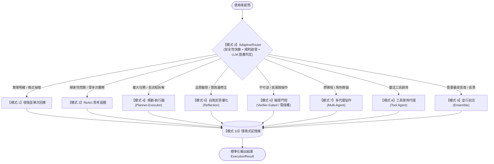

# Adaptive Agent Router (自適應動態路由器公版)

> 🎯 **「選對模式 × 找對場景 × 打造可靠的 AI Agent」**
> 
> 本專案為通用公版架構（Boilerplate / Starter Kit），旨在解決 AI Agent 開發時「一種架構無法包打天下」的痛點。透過 **模式 3 (路由器 Router)** 作為智慧大腦入口，根據使用者的提問意圖、複雜度與風險等級，**自動動態切換**至最合適的 Agent 執行架構模式。

---

## 🗺️ 十大 AI Agent 設計模式對照表

本公版完整對照現代企業級 AI Agent 十大設計架構：

| 編號 | 模式名稱 | 適用場景 | 本專案實作模組 |
| :--- | :--- | :--- | :--- |
| **1** | **增強型 LLM (單次回應)** | 格式轉換、欄位抽取、文字整理、低延遲問答 | `modes/mode_single_turn.py` |
| **2** | **反思迴圈 (ReAct)** | 思考 ➜ 執行 ➜ 觀察，無固定路徑的探索任務 | `modes/mode_react.py` |
| **3** | **路由器 (Router)** | **【核心核心】先分析需求，自動導向最適架構** | `router_app/router.py` |
| **4** | **規劃 - 執行器 (Planner-Executor)** | 跨步驟長流程、架構拆解、可平行處理之複雜專案 | `modes/mode_planner.py` |
| **5** | **評估 - 優化 (自我反思 Reflection)** | 法務合約審查、醫療/財務報告、程式碼漏洞挑刺 | `modes/mode_reflection.py` |
| **6** | **驗證門控 (Verifier-Gated)** | 資料庫寫入/刪除、券商下單、付款授權 (不可逆操作) | `modes/mode_verifier_gated.py` |
| **7** | **多代理協作 (Multi-Agent)** | 跨部門/跨角色圓桌會議、紅藍軍對抗辯論 | `modes/mode_multi_agent.py` |
| **8** | **工具使用代理 (Tool Use)** | 精準選擇外部 API、資料庫與系統工具呼叫 | `modes/mode_tool_agent.py` |
| **9** | **並行自洽 (Ensemble / Self-Consistency)** | 多模型生成、多數決投票、高一致性結論 | `modes/mode_ensemble.py` |
| **10** | **情境式記憶 (Semantic Memory)** | 長期對話記憶喚醒、使用者習慣累積 | `memory/memory_manager.py` |

---

## 🏗️ 系統架構運作流程



---

## 📂 專案目錄結構

```text
AdaptiveAgentRouter/
├── README.md                  # 本說明文件
├── requirements.txt           # 依賴套件清單
├── .env.example               # 環境變數與模型設定範本
├── router_app/                # 核心模組套件
│   ├── __init__.py            # 統一導出入口
│   ├── types.py               # Pydantic 資料型別 (RoutingDecision, ExecutionResult)
│   ├── config.py              # 設定與模型配置
│   ├── router.py              # 核心動態路由器 (安全門控 + 規則 + LLM 分流)
│   ├── dispatcher.py          # 自適應調度總管 (統一對外 API)
│   ├── modes/                 # 十大模式實作目錄
│   │   ├── base.py            # BaseAgentMode 抽象介面
│   │   ├── mode_single_turn.py
│   │   ├── mode_react.py
│   │   ├── mode_planner.py
│   │   ├── mode_reflection.py
│   │   ├── mode_verifier_gated.py
│   │   ├── mode_multi_agent.py
│   │   ├── mode_tool_agent.py
│   │   └── mode_ensemble.py
│   ├── memory/                # 記憶體模組
│   │   └── memory_manager.py
│   └── tools/                 # 可插拔工具模組
│       ├── base_tool.py       # BaseTool 標準介面
│       └── common_tools.py    # 預設通用工具 (DB, Search, Calculator)
└── examples/                  # 應用示範
    ├── quickstart.py          # 基礎快速啟動範例
    ├── plug_into_ocr_example.py   # 套進 OCR 發票辨識專案示範
    └── plug_into_stock_example.py # 套進台股投研風控專案示範
```

---

## 🚀 快速上手 (Quickstart)

### 1. 安裝環境
```bash
cd /Users/yueh-lin/SynologyDrive/02_Work_Projects/soetek/SourceCode/AdaptiveAgentRouter
pip install -r requirements.txt
```

### 2. 執行示範
執行快速全模式自動分流演示：
```bash
python examples/quickstart.py
```

---

## 🔌 如何在其他專案中直接套用？

只要 3 步即可將此公版嵌入任何既有專案：

```python
import sys
# 1. 引入公版路徑
sys.path.append("/path/to/SourceCode/AdaptiveAgentRouter")

from router_app import AdaptiveAgentDispatcher, BaseTool

# 2. 定義你的專屬業務工具 (例如 OCR 辨識、ERP 資料庫查詢、股市即時報價)
class MyProjectTool(BaseTool):
    name = "custom_project_worker"
    description = "執行專案核心任務"
    risk_level = "low"  # 或 "critical"

    def execute(self, **kwargs):
        return "執行完畢！"

# 3. 實例化總管並使用
agent = AdaptiveAgentDispatcher(custom_tools=[MyProjectTool()])

# 丟入任何問題，系統自動幫你決定該走單次、ReAct、Planner 還是安全門控！
result = agent.process("請幫我規劃一套完整系統方案")
print(result.output)
```

---

## 🛡️ 安全門控機制 (Human-in-the-Loop)

當使用者提問包含以下特徵時，系統**絕對不會直接執行**，而是切換至 `mode_6_verifier_gated`：
- 關鍵字快篩：`刪除`、`drop`、`清空`、`下單`、`轉帳`、`付款`
- 風險等級自動標記為 `CRITICAL`
- 觸發人工簽核審批攔截，防止 Agent 誤操作造成系統不可逆損害。
