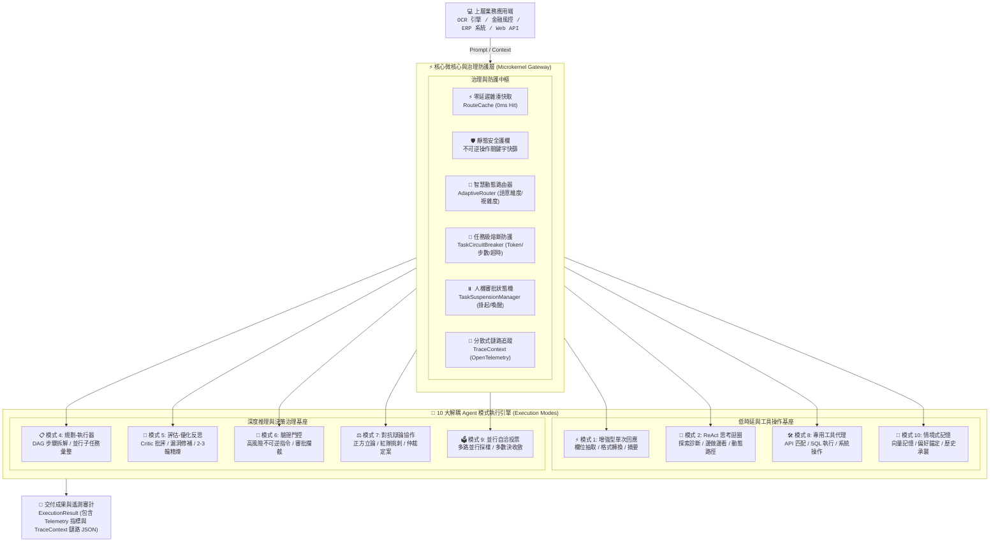

# 企業級 AI Agent 自適應動態調度中樞與微架構框架 (AdaptiveAgentRouter)

**AdaptiveAgentRouter** 是一套專為大型語言模型（LLM）智慧代理系統打造之企業級**自適應動態調度中樞與微架構框架**。系統採用微核心解耦架構（Microkernel Dispatcher），在毫秒級時延內對使用者提問進行多維度語意分析、任務複雜度分級與不可逆風險評估，動態分流至**十大標準 Agent 設計模式**（包含增強型單次回應、ReAct 思考迴圈、Planner-Executor 任務拆解、自我反思批評、驗證門控、三權分立對抗辯論等），並原生內建零延遲雜湊快取、任務級熔斷保護器（Circuit Breaker）、非同步人機協同審批狀態機（Suspend & Resume），以及相容 OpenTelemetry 之全鏈路分散式追蹤，專供複雜企業級 AI 系統（如智慧 OCR 憑證解析、量化投資研究、ERP 核心流程自動化）在生產環境中實現低延遲、可治理、抗暴走之高可靠性代理運維。

[](https://www.python.org/)
[]()
[]()
[]()
[]()
[](https://opensource.org/licenses/MIT)

---

## 1. 系統架構 (System Architecture)

系統遵循微核心與外掛解耦設計模式（Microkernel Architecture），調度總管維持極致輕量化，並將核心路由治理機制與 10 大執行引擎徹底實體隔離。



---

## 2. 核心架構特色與技術支柱 (Architectural Pillars)

### 2.1 微核心熱插拔架構 (Microkernel Plug-and-Play Engine)
調度中樞 `AdaptiveAgentDispatcher` 與各專案業務邏輯徹底解耦。使用者只需定義繼承自 `BaseTool` 的業務工具，即可無縫掛載進系統；所有執行模式（Modes）均實作統一介面契約，具備獨立擴充與替換能力。

### 2.2 零延遲語意與精確雜湊快取 (Zero-Latency Route Cache Layer)
針對生產環境中高頻發生的相似查詢，引入基於正規化字串的 SHA-256 記憶體 LRU 雜湊快取層 `RouteCache`。快取命中時直接略過分類推論，實現 **0ms 路由判定**，杜絕無謂的 Token 浪費與前置時延。

### 2.3 任務級熔斷器與防暴走護欄 (Task Circuit Breaker & Token Guard)
為防止 ReAct 模式陷入死循環或 Multi-Agent 辯論無限發散，系統為每個任務實例化獨立的 `TaskCircuitBreaker` 生命週期監控：
- **最大步數門檻**：預設上限 8 步，超標立即主動熔斷。
- **Token 預算硬上限**：單一任務上限預設 8,000 Tokens，杜絕帳單暴增風險。
- **逾時熔斷**：30 秒非同步中斷保護，保障微服務工作線程不被鎖死。

### 2.4 非同步人機協同審批狀態機 (Non-blocking Human-in-the-Loop Suspension)
捨棄傳統本機控制台阻塞式 `input()` 設計，採用現代微服務適配的有限狀態機（FSM）：
1. 偵測到 `CRITICAL` 不可逆操作時，`TaskSuspensionManager` 序列化上下文並持久化，生成唯一的 `task_id`，立即釋放 Worker 執行緒。
2. 外部系統（Webhook、微服務 API、Slack 機器人或企業審批流）接收審核信號後，呼叫 `dispatcher.resume_task(task_id, approved=True)` 喚醒任務並放行執行。

### 2.5 三權分立對抗辯論引擎 (Dialectical Debate Engine)
重構傳統多代理「各說各話」的無效協作，升級為結構化辯論模型：
- **正方架構師 (Pitch)**：提出最佳化推進行動方案與價值論證。
- **反方紅隊 (Challenge)**：針對高併發極限、依賴失效與隱性成本進行極限邊界挑刺。
- **首席仲裁者 (Final Verdict)**：綜合雙方攻防論述，權衡利弊並給出具備安全約束之確定性定案。

### 2.6 分散式全鏈路可觀測性 (Distributed Tracing Alignment)
遵循 OpenTelemetry 語意標準，原生實作 `TraceContext` 與 `TraceSpan`。每次調用生成全域唯一的 `trace_id`，詳細記錄路由決策、快取狀態、各階段耗時與模式執行軌跡，直接輸出結構化審計日誌。

---

## 3. 十大 Agent 設計模式分流矩陣 (Decision Matrix)

| 模式代碼 | 架構模式名稱 | 決策特徵與觸發情境 | 時延等級 | 容錯與驗證策略 |
| :--- | :--- | :--- | :--- | :--- |
| `mode_1_single_turn` | 增強型單次回應 | 結構化資料抽取、單表欄位轉換、摘要、封閉式問答 | 極低 (< 1s) | 一次性推論，無迭代開銷 |
| `mode_2_react` | 反思迴圈 (ReAct) | 動態探索、未知錯誤排查、邊做邊看的非固定路徑任務 | 中等 (1-3s) | 思考-行動-觀察三段式迴圈，預設 5 輪上限 |
| `mode_3_router` | 動態路由器 | 系統母體入口，負責語意多維分析、複雜度評估與風險分流 | 極低 (< 0.2s) | 雜湊快取 ➜ 靜態關鍵字 ➜ 輕量 LLM |
| `mode_4_planner` | 規劃-執行器 | 跨模組長流程、架構規劃、百萬級批次作業分解 | 偏高 (3-8s) | DAG 依賴拆解，工作者並行執行後彙整校驗 |
| `mode_5_reflection` | 評估-優化反思 | 商業合約、法務合規、核心演算法優化、高單價方案審查 | 偏高 (3-6s) | Generator ➜ Critic 挑刺 ➜ Optimizer 改寫 (2-3 輪) |
| `mode_6_verifier_gated` | 驗證門控 | 包含 DELETE, DROP, 付款, 券商下單等不可逆指令 | 依審批而定 | 觸發 TaskSuspensionManager 掛起，需顯式外部審批 |
| `mode_7_multi_agent` | 對抗辯論協作 | 涉及跨領域權衡、高爭議性方案決策、紅藍對抗審查 | 偏高 (3-5s) | 三權分立：正方立論 ➜ 紅隊挑刺 ➜ 首席仲裁者定案 |
| `mode_8_tool_use` | 工具使用代理 | 需動態挑選與組合外部 API、SQL、系統命令之通用場景 | 中等 (1-3s) | 動態 Schema 匹配與執行例外捕獲 |
| `mode_9_ensemble` | 並行自洽投票 | 複雜數學推演、邏輯定理驗證、極端低容錯決策情境 | 高 (多路並行) | 多路並行採樣後多數決 (Consensus Voting) |
| `mode_10_memory` | 情境式長期記憶 | 使用者偏好錨定、歷史決策繼承、跨階段狀態維持 | 低 (< 50ms) | 上下文注入前先檢索語意快照與歷史偏好 |

---

## 4. 介面契約與呼叫規範 (API Specification)

### 4.1 核心調度介面
```python
def process(
    prompt: str,
    context: Optional[Dict[str, Any]] = None,
    forced_mode: Optional[AgentMode] = None,
    trace_id: Optional[str] = None,
) -> ExecutionResult:
```
* **傳入參數**：
  - `prompt` (str): 使用者輸入之原始問題或任務需求。
  - `context` (dict, optional): 業務上下文變數（如使用者權限、環境標籤、專案設定）。
  - `forced_mode` (AgentMode, optional): 強制指定模式，繞過自動路由機制。
  - `trace_id` (str, optional): 外部傳入之分佈式 Trace ID；若未提供則自動生成。
* **回傳型別**：
  - `ExecutionResult`: 包含 `output` (結果本文)、`mode_used` (執行模式)、`metadata` (包含 Telemetry 指標與 TraceContext 鏈路 JSON)。

### 4.2 非同步任務掛起與審批恢復介面
```python
def resume_task(
    task_id: str, 
    approved: bool = True
) -> ExecutionResult:
```
* **傳入參數**：
  - `task_id` (str): 由門控機制掛起時產生之任務 UUID。
  - `approved` (bool): 審批決定；傳入 `True` 放行執行，傳入 `False` 立即中止並標記拒絕。

---

## 5. 快速整合指南 (Quickstart Integration)

### 步驟 1: 安裝基礎環境
```bash
git clone https://github.com/yarin0324/adaptive-agent-router.git
cd adaptive-agent-router
pip install -r requirements.txt
```

### 步驟 2: 掛載至業務專案 (以發票 OCR 辨識為例)
```python
import sys
sys.path.append("/path/to/adaptive-agent-router")

from router_app import AdaptiveAgentDispatcher, BaseTool

# 1. 宣告業務專屬工具
class InvoiceOCRTool(BaseTool):
    name = "invoice_ocr_parser"
    description = "對發票影像執行版面分析與欄位抽取"
    risk_level = "low"

    def execute(self, image_path: str = "", **kwargs):
        # 封裝底層 OCR 函式庫
        return {"invoice_no": "AA-12345678", "total": 5200}

# 2. 實例化調度器
dispatcher = AdaptiveAgentDispatcher(
    custom_tools=[InvoiceOCRTool()],
    enable_logging=True
)

# 3. 執行智慧調度 (系統自動判定為 mode_1_single_turn 並調用 OCR)
result = dispatcher.process("請幫我抽取 invoice_01.png 的統編與總金額，整理成 JSON")
print(result.output)
```

---

## 6. 目錄結構與模組邊界 (Repository Structure)

```text
adaptive-agent-router/
├── README.md                      # 企業級系統架構白皮書與技術規格書
├── requirements.txt               # 執行期最小依賴庫
├── .env.example                   # LLM 端點與金鑰配置範本
├── .gitignore                     # Git 忽略規則
├── router_app/                    # 核心函式庫 (Core Package)
│   ├── types.py                   # Pydantic 資料合約 (RoutingDecision, ExecutionResult)
│   ├── config.py                  # 系統環境參數與門檻設定
│   ├── router.py                  # 動態路由中樞 (安全快篩 + 啟發式規則 + 語意判定)
│   ├── dispatcher.py              # 調度總管 (Microkernel Dispatcher 統一入口)
│   ├── cache/                     # 路由快取層 (RouteCache 0ms 哈希快取)
│   ├── tracing/                   # 可觀測性追蹤層 (TraceContext, TraceSpan)
│   ├── guardrails/                # 治理防護層 (TaskCircuitBreaker, TaskSuspensionManager)
│   ├── memory/                    # 情境記憶層 (MemoryManager)
│   ├── modes/                     # 10 大標準模式實作引擎
│   └── tools/                     # 工具抽象規範與通用工具庫 (BaseTool)
└── examples/                      # 系統驗證與範例
    ├── quickstart.py              # 整合驗證示範 (快取、辯論、審批掛起實測)
    ├── plug_into_ocr_example.py   # OCR 智慧辨識專案整合範例
    └── plug_into_stock_example.py # 金融量化與風控專案整合範例
```
