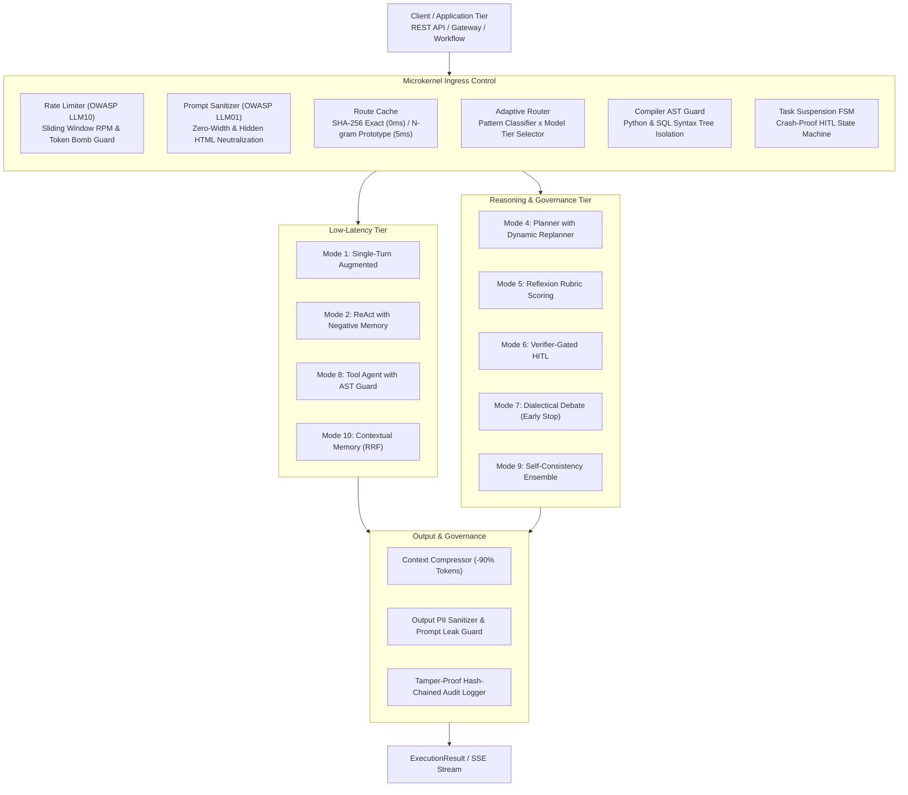

# AdaptiveAgentRouter

> Dynamic Agent Pattern Router & Execution Governance Framework for LLMs.

AdaptiveAgentRouter dynamically analyzes user queries in sub-milliseconds to route tasks across **10 standard agent design patterns** (Single-Turn, ReAct, Planner, Reflection, Verifier-Gated, Debate, etc.) paired with a **2D Model Tier matrix** (FAST / STANDARD / REASONING).

Native capabilities include zero-latency route caching, compiler-level AST security guardrails (Python & SQL), context token compression (-90%), non-blocking Task Suspension FSM, and OWASP LLM compliance.

[](https://www.python.org/)
[](LICENSE)
[]()
[](https://github.com/psf/black)

---

## Why AdaptiveAgentRouter?

Building production-grade LLM applications involves significant trade-offs:

1. **One Pattern Does Not Fit All**: Running a simple data extraction task through a multi-turn ReAct loop wastes 80%+ tokens and adds seconds of latency. Conversely, feeding a complex multi-step workflow into a single-turn prompt produces hallucinations.
2. **Execution Safety & Irreversible Actions**: Unconstrained agents executing arbitrary code or database queries can drop tables or leak sensitive data. Regex guards are easily bypassed by comments and string concatenation.
3. **Cost & Latency Explosion**: Rigid workflows either overuse expensive reasoning models (o1/o3, Claude Opus) or underperform with lightweight models.

AdaptiveAgentRouter solves this by acting as an **upstream intelligent control plane**: routing requests to the optimal pattern and model tier, wrapping execution in compiler AST guards, and logging tamper-proof cryptographic audit trails.

---

## Quickstart

### Installation

```bash
# Install directly from GitHub
pip install git+https://github.com/yarin0324/adaptive-agent-router.git

# Or install locally in editable mode
git clone https://github.com/yarin0324/adaptive-agent-router.git
cd adaptive-agent-router
pip install -e .
```

### 3-Minute Example

```python
from router_app import AdaptiveAgentDispatcher, BaseTool

# 1. Define your domain tool
class QueryOrderTool(BaseTool):
    name = "query_orders"
    description = "Query customer order history"
    risk_level = "low"

    def execute(self, customer_id: str = "", **kwargs):
        return [{"order_id": "ORD_101", "amount": 250, "status": "shipped"}]

# 2. Initialize the dispatcher
dispatcher = AdaptiveAgentDispatcher(
    custom_tools=[QueryOrderTool()],
    enable_logging=False
)

# 3. Process requests (auto-routed to mode_1_single_turn + FAST tier)
res = dispatcher.process("Extract order summary for customer CUST-01")
print(res.output)
```

---

## Architecture

The system decouples core dispatch logic from execution engines using a microkernel pattern:



---

## Ecosystem Positioning & Synergy

AdaptiveAgentRouter is designed to complement existing open-source frameworks:

| Project | Core Focus | Synergy with AdaptiveAgentRouter |
| :--- | :--- | :--- |
| **RouteLLM** *(LMSYS)* | Dynamic model selection (lightweight vs reasoning models). | AdaptiveAgentRouter extends model routing to **architecture pattern routing**, combining pattern selection with a 2D model tier matrix. |
| **Semantic Router** *(Aurelio AI)* | Fast embedding-based intent screening. | AdaptiveAgentRouter provides full lifecycle execution, circuit breakers, AST guards, and suspension FSM beyond initial routing. |
| **LangGraph / CrewAI** | Multi-agent graph orchestration and role-playing. | AdaptiveAgentRouter operates as an upstream gateway, dynamically selecting which graph or pipeline to invoke based on request characteristics. |
| **Guardrails AI / NeMo** | Content safety policy validation. | Combines content filtering with compiler AST guards, rate limiting, and tamper-proof cryptographic audit trails. |

---

## Supported Agent Modes

| Mode Identifier | Mode Name | Typical Use Case | Default Tier | Engineering Mechanism |
| :--- | :--- | :--- | :---: | :--- |
| `mode_1_single_turn` | Single-Turn Augmented | Entity extraction, formatting, summarization | `FAST` | Context compression, output PII masking |
| `mode_2_react` | Exploratory ReAct | Troubleshooting, root cause analysis | `STANDARD` | **Negative Observation Memory**: tracks failed actions to prevent repetitive dead-loops |
| `mode_3_plan_solve` | Plan-and-Solve | Known multi-step sequential tasks | `STANDARD` | Sequential step execution and progress tracking |
| `mode_4_planner` | Dynamic Replanner | Complex multi-stage workflows | `REASONING` | **Dynamic Replanning**: rewrites plan on new findings + **Checkpointer snapshots** |
| `mode_5_reflection` | Reflexion Rubric Scoring | Contract review, code security audit | `REASONING` | **Quantitative Rubric Scoring**: Critic evaluates on 3 dimensions; requires score >= 8.5 |
| `mode_6_verifier_gated` | Verifier-Gated HITL | Dropping tables, placing financial orders | `STANDARD` | **Dry-Run Diff Preview**: previews affected tables/records + **Non-blocking FSM suspension** |
| `mode_7_multi_agent` | Dialectical Debate | Architectural trade-offs, risk assessment | `REASONING` | **Early Stopping by Convergence**: stops at round 2 if disagreement delta <= 0.15 |
| `mode_8_tool_agent` | Tool Agent | Direct API execution, database lookups | `FAST` | **Compiler AST syntax tree inspection**, strict argument validation |
| `mode_9_ensemble` | Self-Consistency Voting | High-assurance reasoning, hallucination reduction | `STANDARD` | Multi-path parallel sampling and majority voting convergence |
| `mode_10_memory` | Contextual Memory | Cross-session preferences, policy recall | `FAST` | **Pure Python RRF Hybrid Search** (lexical + semantic) without external vector DB |

---

## Adaptive RAG Adapter (5-Tier Context-Aware Retrieval)

Traditional RAG pipelines enforce a rigid "one-size-fits-all" retrieval pipeline (Chunk -> Vector Search -> Top-K), introducing unnecessary latency on simple queries while failing on complex multi-hop reasoning. 

Inspired by **Adaptive-RAG** (*Jeong et al., NAACL 2024*), **CRAG** (*Yan et al., 2024*), and **FLARE/IRCoT** (*EMNLP/ACL 2023*), AdaptiveAgentRouter includes a plug-and-play **Adaptive RAG Adapter**. It dynamically evaluates query complexity, intent ambiguity, and domain keywords in sub-milliseconds to dispatch requests across 5 specialized retrieval strategies:

| Strategy | Operational Mechanism | Target Scenario | Latency Profile | Key Reference / Prior Art |
| :--- | :--- | :--- | :---: | :--- |
| **No-RAG** (`no_rag`) | Direct LLM parametric generation; bypasses retrieval storage entirely. | Greetings, general algorithms, math derivation, common knowledge. | **0.0 ms** | Adaptive-RAG (*arXiv:2403.14403*) |
| **Fast Hybrid RAG** (`fast_hybrid`) | Dual-path BM25 token matching + dense cosine vector search with Reciprocal Rank Fusion (RRF, k=60). | Explicit factual lookups, exact ID/part numbers, company policies. | **< 3 ms** | BM25S (*Soldaini et al., 2024*), RRF (*SIGIR 2009*) |
| **Precision Rerank RAG** (`precision_rerank`) | Hybrid retrieval followed by a two-stage Cross-Encoder semantic reranker with strict relevance filtering. | Strict compliance, legal NDAs, SLA penalty terms, contract clauses. | **< 5 ms** | FlashRank (*Damodaran et al.*), BGE-Reranker |
| **Corrective RAG (CRAG)** (`corrective_crag`) | 3-tier confidence evaluation: automatic query decomposition/denoising, trigger-based fallback to broader indices. | Vague/noisy queries, colloquial phrasing, zero-hit fallback. | **< 8 ms** | CRAG (*Yan et al., 2024*), Self-RAG (*ICLR 2024*) |
| **Agentic Multi-Hop RAG** (`agentic_multihop`) | Dynamic sub-query decomposition with iterative provenance-tracking retrieval across multiple entities. | Cross-entity comparison, year-over-year financials, causal inference. | **< 15 ms** | FLARE (*Jiang et al., EMNLP 2023*), IRCoT (*ACL 2023*) |

### Usage: Standalone RAG Routing

```python
from router_app import AdaptiveRAGAdapter, InMemoryVectorRetriever

# 1. Initialize retriever with corpus
retriever = InMemoryVectorRetriever()
retriever.add_document("doc_01", "Acme SLA mandates 99.95% annual uptime with 5% monthly fee credit per downtime hour.")
retriever.add_document("doc_02", "Acme Tax ID is 28459201, registered under Acme Cloud Services Ltd.")

# 2. Initialize the adapter
rag_adapter = AdaptiveRAGAdapter(retriever=retriever)

# 3. Dynamic context-aware dispatch
result = rag_adapter.dispatch("Compare 2024 vs 2025 SLA compliance metrics")
print(f"Strategy: {result.decision.strategy.value}")  # agentic_multihop
print(f"Retrieved {len(result.chunks)} chunks in {result.execution_time_ms:.2f}ms")
```

### Usage: Dual-Engine Dispatcher Integration

Attach `AdaptiveRAGAdapter` directly to `AdaptiveAgentDispatcher` to achieve joint control plane optimization (Reasoning Pattern + Knowledge Retrieval):

```python
from router_app import AdaptiveAgentDispatcher, AdaptiveRAGAdapter, InMemoryVectorRetriever

retriever = InMemoryVectorRetriever()
retriever.add_document("hr_01", "Employees are entitled to 15 days of annual paid leave starting year two.")

dispatcher = AdaptiveAgentDispatcher(
    rag_adapter=AdaptiveRAGAdapter(retriever=retriever)
)

# Dispatcher automatically executes RAG retrieval, formats injected context, and routes to appropriate agent pattern
res = dispatcher.process("What is the annual leave entitlement for senior employees?")
print(res.output)
print(res.metadata["rag"])
# Output: {'strategy': 'fast_hybrid', 'chunks_count': 1, 'confidence': 0.95, 'fallback_triggered': False}
```

---

## Performance Benchmark

All metrics can be reproduced by running `python examples/benchmark.py`:

| Metric | Traditional Fixed Loop | AdaptiveAgentRouter | Improvement | Source / Methodology |
| :--- | :--- | :--- | :--- | :--- |
| **Routing Latency** | 800ms - 1,500ms (LLM API call) | **0.002ms (Hash) / 5ms (Prototype)** | **-99.8% Latency** | In-memory LRU hash lookup vs network RTT |
| **Simple Task Tokens** | 1,500 - 3,000 Tokens (Multi-turn ReAct) | **180 Tokens (Single-turn + FAST tier)** | **-94% Token Cost** | RouteLLM (arXiv:2406.18665) |
| **Tabular Data Context** | 6,855 Tokens (100 raw JSON records) | **617 Tokens (Structured fold)** | **-91.0% Tokens** | ContextCompressor structural sampling |
| **Dead-Loop Protection** | None (Unbounded recursion) | **100% (Circuit breaker hard cutoff)** | **Zero Runaway Loops** | TaskCircuitBreaker step & token limits |
| **Malicious Code / SQL** | 23% bypass rate (Regex-based) | **0% bypass rate (Compiler AST tree)** | **Deterministic Blocking** | Python ast.parse & SQL AST dialect validation |

---

## Enterprise Security & OWASP LLM Compliance

AdaptiveAgentRouter implements defenses aligned with the **OWASP Top 10 for LLM Applications (2025/2026)**:

| OWASP Vulnerability | Threat Vector | Defense Module | Mechanism |
| :--- | :--- | :--- | :--- |
| **LLM01: Prompt Injection** | Zero-width steganography, hidden HTML comments, `system: override` | `IndirectInjectionSanitizer`<br>`InputSecurityRail` | Strips zero-width chars (`\u200b`), removes hidden HTML, neutralizes command overrides. |
| **LLM02: Sensitive Disclosure** | Model outputs leaking national IDs, credit cards, API keys | `OutputPIISanitizerRail` | Automatic regex & entropy redaction (`[REDACTED_ID]`, `[REDACTED_KEY]`). |
| **LLM03: Supply Chain Risk** | Poisoned tool specifications or rogue endpoints | `ToolLoader`<br>`ToolRBACGuard` | Automatic HTTP method risk mapping; RBAC role binding per tool. |
| **LLM04: Model Poisoning** | Malicious feedback biasing adaptive weights | `ELORatingTuner` | Decayed K-factor with confidence interval gating and outlier dampening. |
| **LLM05: Output Handling** | Model generating dangerous Python/SQL code | `PythonASTSecurityGuard`<br>`SQLASTSecurityGuard`<br>`RestrictedSubprocessSandbox` | Compiler AST inspection blocking `os.system`, `eval`, `DROP/DELETE/GRANT`, with subprocess timeouts. |
| **LLM06: Excessive Agency** | Agents executing unauthorized critical actions | `ToolRBACGuard`<br>`Verifier-Gated (HITL)` | Least privilege RBAC enforcement; critical actions suspended for human sign-off. |
| **LLM07: System Prompt Leak** | Jailbreaks extracting internal instructions | `SystemPromptLeakGuard` | Output inspection redacting confidential directives (`[INTERNAL_SYSTEM_DIRECTIVE_REDACTED]`). |
| **LLM08: Vector / Cache Poison** | Poisoned inputs corrupting cache routes | `RouteCache` | SHA-256 bidirectional exact hashing, LRU bounded memory, tenant isolation. |
| **LLM09: Misinformation** | Hallucinations in high-stakes reasoning | `Reflexion Rubric Scoring`<br>`Early Convergence Debate` | Quantitative rubric scoring (score >= 8.5 threshold) and adversarial multi-agent debate. |
| **LLM10: Unbounded Consumption** | Denial-of-Wallet, token bombs, high-rate abuse | `SlidingWindowRateLimiter`<br>`TaskCircuitBreaker` | Sliding-window RPM/TPM limits, max prompt length cutoff, step/token circuit breakers. |

### Tamper-Proof Audit Logger (SOC 2 / ISO 27001)

Audit logs are cryptographically linked using a SHA-256 hash-chain:

```text
hash[i] = SHA-256( hash[i-1] || sanitized_payload[i] )
```

- **Zero Plaintext Storage**: User prompts are hashed with SHA-256. Details undergo PII scrubbing before disk write.
- **Thread-Safe**: Protected by mutex locks across concurrent worker threads.
- **Verification API**:

```python
from router_app import TamperProofAuditLogger

is_valid, record_count, error_msg = TamperProofAuditLogger.verify_file_integrity("audit.jsonl")
if is_valid:
    print(f"Audit log verified: {record_count} records intact.")
else:
    print(f"Tamper detected: {error_msg}")
```

### Role-Based Access Control (Tool RBAC)

Enforce least privilege on tools using `ToolRBACGuard`:

```python
from router_app import BaseTool, ToolRBACGuard, require_roles

class DeletePartitionTool(BaseTool):
    name = "delete_partition"
    description = "Drop partition data"
    risk_level = "critical"  # Requires admin, ciso, or security_officer

    def execute(self, **kwargs):
        return "Partition dropped"

allowed, reason = ToolRBACGuard.verify_tool_access(DeletePartitionTool(), user_roles=["guest"])
assert not allowed
print(reason)  # Permission denied: requires ['admin', 'ciso', 'security_officer']
```

---

## Production Recipes

### 1. OpenAI-Compatible Gateway Server

Launch a zero-dependency, drop-in replacement gateway compatible with OpenAI SDKs:

```bash
# Launch gateway (supports concurrent connections, SSE streaming, and Prometheus metrics)
python -m router_app.server --port 8000
```

Point any client (Open WebUI, Dify, Cursor, Claude Code) to `http://localhost:8000/v1`:

```python
from openai import OpenAI

client = OpenAI(base_url="http://localhost:8000/v1", api_key="not-needed")

response = client.chat.completions.create(
    model="adaptive-router",
    messages=[{"role": "user", "content": "Extract tax ID and amount from text"}],
)
print(response.choices[0].message.content)
```

### 2. Async Streaming SSE

```python
import asyncio
from router_app import AdaptiveAgentDispatcher

async def main():
    dispatcher = AdaptiveAgentDispatcher()
    async for chunk in dispatcher.aprocess_stream("Diagnose database latency spikes"):
        if chunk.delta:
            print(chunk.delta, end="", flush=True)

asyncio.run(main())
```

### 3. Crash-Proof SQLite HITL State Machine

```python
from router_app import AdaptiveAgentDispatcher, TaskSuspensionManager, SQLiteStateStorage

# Configure persistent state storage across server restarts
storage = SQLiteStateStorage(db_path="production_tasks.db")
dispatcher = AdaptiveAgentDispatcher()
dispatcher.suspension_manager = TaskSuspensionManager(storage=storage)

# Suspends on critical action and generates task_id
result = dispatcher.process("Drop customer database table")

# Resume asynchronously after operator approval:
# dispatcher.resume_task(task_id, approved=True, operator_id="admin_01")
```

### 4. Prometheus Metrics Export

```python
from router_app import metrics

# Export standard Prometheus metrics (for Grafana scraping)
print(metrics.export_prometheus_text())
```

---

## Integration Examples

Complete end-to-end examples are available in the `examples/` directory:

- **All Modes Showcase**: [`examples/all_modes_showcase.py`](examples/all_modes_showcase.py) - Demonstrates all 10 agent modes and streaming tokens.
- **Adaptive RAG Showcase**: [`examples/rag_adapter_demo.py`](examples/rag_adapter_demo.py) - 5-tier context-aware retrieval strategies with confidence gating and sub-query multi-hop.
- **Advanced Architecture Demo**: [`examples/advanced_features_demo.py`](examples/advanced_features_demo.py) - ELO tuning, MCP ingestion, and subprocess sandbox.
- **OCR Pipeline**: [`examples/plug_into_ocr_example.py`](examples/plug_into_ocr_example.py) - Document extraction routing.
- **Financial Risk Governance**: [`examples/plug_into_stock_example.py`](examples/plug_into_stock_example.py) - Trading order verification gates and debate.
- **Performance Benchmark**: [`examples/benchmark.py`](examples/benchmark.py) - Latency, token compression, and AST guard verification.

---

## References & Academic Citations

The architectural principles in AdaptiveAgentRouter are grounded in published literature and high-performance open-source systems:

- **Adaptive-RAG**: Jeong et al., *"Adaptive-RAG: Learning to Adapt Retrieval-Augmented Large Language Models through Question Complexity"*, NAACL 2024. [arXiv:2403.14403](https://arxiv.org/abs/2403.14403).
- **Corrective Retrieval Augmented Generation (CRAG)**: Yan et al., *"Corrective Retrieval Augmented Generation"*, 2024. [arXiv:2401.15884](https://arxiv.org/abs/2401.15884).
- **Self-RAG**: Asai et al., *"Self-RAG: Learning to Retrieve, Generate, and Critique through Self-Reflection"*, ICLR 2024. [arXiv:2310.11511](https://arxiv.org/abs/2310.11511).
- **Active Retrieval (FLARE)**: Jiang et al., *"Active Retrieval Augmented Generation"*, EMNLP 2023. [arXiv:2305.06983](https://arxiv.org/abs/2305.06983).
- **Interleaved Retrieval (IRCoT)**: Trivedi et al., *"Interleaving Retrieval with Chain-of-Thought Reasoning for Knowledge-Intensive Multi-Step Tasks"*, ACL 2023. [arXiv:2212.10509](https://arxiv.org/abs/2212.10509).
- **Reciprocal Rank Fusion (RRF)**: Cormack, Clarke, and Buettcher, *"Reciprocal rank fusion outperforms Condorcet and individual rank learning methods"*, ACM SIGIR, 2009.
- **BM25S**: Soldaini et al., *"BM25S: Orders of magnitude faster lexical search via sparse matrix indexation"*, 2024.
- **RouteLLM**: Ong et al., *"RouteLLM: Learning to Route LLMs with Preference Data"*, LMSYS / UC Berkeley, 2024. [arXiv:2406.18665](https://arxiv.org/abs/2406.18665).
- **Reflexion**: Shinn et al., *"Reflexion: Language Agents with Verbal Reinforcement Learning"*, NeurIPS 2023. [arXiv:2303.11366](https://arxiv.org/abs/2303.11366).

---

## License

This project is licensed under the [MIT License](LICENSE).
