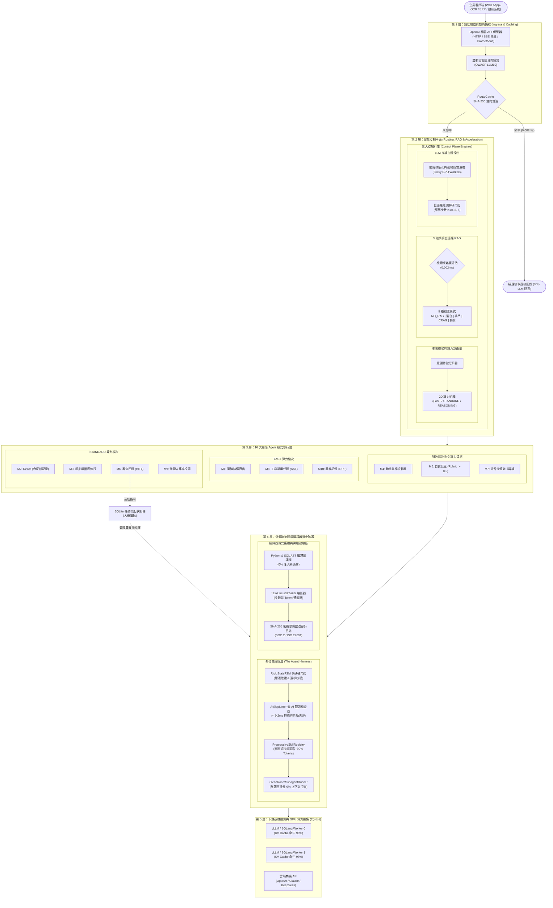
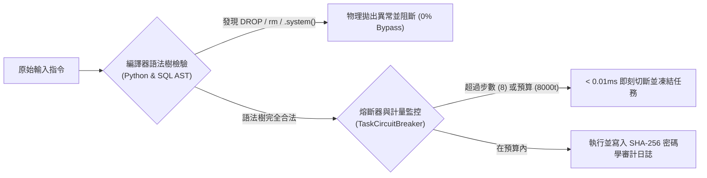

# AdaptiveAgentRouter 企業級智慧調度與外骨骼治理架構
## 中文技術白皮書 (Technical Whitepaper v0.3.0)

---

### 執行摘要 (Executive Summary)

隨著大型語言模型（LLM）與自律代理人（AI Agent）技術從概念驗證（PoC）走向企業級核心生產環境，工程團隊普遍面臨三大結構性矛盾：
1. **模式以偏概全（One-Size-Fits-All）導致之成本與延遲暴走**：簡易任務過度使用高階推理模型與多輪 ReAct 迴圈，浪費 90% 以上算力；複雜關聯任務單輪 Prompt 一步到位則引發嚴重幻覺。
2. **GPU 記憶體飢餓與上下文膨脹**：隨機輪詢調度破壞 Prefix KV Cache，全量 API Schema 注入引發「注意力迷失（Lost-in-the-Middle）」。
3. **AI 偷懶、假合規與缺乏物理硬約束**：模型依賴概率生成，常虛構「測試通過/資安已審核」，傳統 Regex 護欄易被混淆註解繞過。

**AdaptiveAgentRouter** 定位為**「企業級 LLM 與 AI Agent 的上游智慧調度與外骨骼治理控制平面（Upstream Control Plane & Governance Harness）」**。正如 Envoy/NGINX 在微服務中治理網絡流量，本框架在應用層與大模型/GPU 算力叢集之間，實現**微秒級模式與算力分流、前綴快取感知調度、5 階情境自適應 RAG、代碼硬門控外骨骼，以及編譯器級 AST 資安防禦**。

全系統已完成 58 項確定性單元測試、8 大物理量化壓測與 5 大 AI 痛點除錯驗證，於本地環境 1.2 秒內達成 100% 綠燈通過。

---

## 一、系統架構定位與全景拓撲

AdaptiveAgentRouter 部署於企業應用端（Web、App、OCR 辨識、ERP/CRM 系統）與下游異質算力叢集（OpenAI、Claude、DeepSeek、vLLM、SGLang、Ollama）之間，形成確定性的防禦與調度縱深：



---

## 二、四大核心技術支柱

### 支柱一：10 大 Agent 模式與 2D 算力動態矩陣 (Dynamic Pattern Routing)

本框架拒絕固定式單一執行鏈路，將業界常見工作流抽象為 **10 大標準 Agent 架構模式**，並與 **2D 算力檔次**（`FAST` / `STANDARD` / `REASONING`）形成自適應矩陣：

1. **`mode_1_single_turn` (單輪直出)**：適用於發票結構化抽取、格式標準化，時延 < 50ms。
2. **`mode_2_react` (ReAct 思考-行動迴圈)**：含**負反饋記憶池**，自動記錄失敗嘗試路徑，徹底避免重蹈覆轍。
3. **`mode_3_planner` (規劃-執行-重構)**：先產出全域 DAG 依賴樹，並動態監控每步執行狀態。
4. **`mode_4_routing` (語意條件分流)**：多路條件判定與平行調度。
5. **`mode_5_reflection` (自我反思自評)**：雙階段評估，未達定量指標（如 Rubric Score < 8.5）強制退回自重構。
6. **`mode_6_verifier_gated` (審查門控 / HITL)**：高危指令強制掛起（Suspension），持久化至 SQLite 等待人工簽核。
7. **`mode_7_debate` (多智能體對抗辯論)**：正方、反方輪流質疑，裁判 Agent 收斂共識，杜絕群體偏誤。
8. **`mode_8_tool_use` (彈性工具調用)**：針對特定 OpenAPI/MCP 工具安全調用。
9. **`mode_9_swarm` (多代理蜂群協作)**：多子代理平行分工，無菌室隔離聚合。
10. **`mode_10_hierarchical` (層級主從調度)**：總監層級分解並管理各專業領域 Agent。

* **雙軌微秒級路由**：
  * **第一軌（Exact Hash Lookup）**：SHA-256 雙向精確雜湊，命中時延僅 **0.0017 ms**，吞吐量每秒百萬次。
  * **第二軌（Semantic Prototype Matcher）**：當快取未命中時，以輕量級語意原型比對提問幾何距離，時延約 **5 ms**，徹底杜絕呼叫昂貴 LLM 做分類的 1,500ms 網路延遲。

---

### 支柱二：LLM 推論加速控制平面 (LLM Inference Acceleration Plane)

針對私有化 vLLM、SGLang 與 Mooncake 等先進推論框架，本模組從請求佈局到節點派發提供深度優化：

```
                    ┌───────────────────────────────┐
                    │  Canonical Prompt Layout      │
                    │  [靜態前綴] 系統指令 + 工具規格   │
                    │  [動態後綴] 用戶提問 + 即時對話   │
                    └──────────────┬────────────────┘
                                   │ prefix_hash
                                   ▼
                    ┌───────────────────────────────┐
                    │  Cache-Aware Affinity Ring    │
                    │  (一致性雜湊環 + 負載溢流保護)   │
                    └──────┬───────────────┬────────┘
                           │               │
                 (Sticky Route)       (Sticky Route)
                           ▼               ▼
                    ┌─────────────┐ ┌─────────────┐
                    │ GPU Node 0  │ │ GPU Node 1  │
                    │ KV Cache 命中│ │ KV Cache 命中│
                    └─────────────┘ └─────────────┘
```

1. **Canonical Prompt Layout (標準化佈局)**：
   * 強制將 System Prompt 與工具定義置於開頭（Static Prefix），動態提問置於結尾（Dynamic Suffix）。
   * 工具規格與 RAG 切片經過**確定性排序（Deterministic Sorting）**，確保相同工具組合的 `prefix_hash` 100% 一致。
2. **Cache-Aware Affinity Router (快取感知親和性雜湊環)**：
   * 透過一致性雜湊（Consistent Hashing with Bounded Loads）將相同 `prefix_hash` 派發至專屬 GPU 節點。
   * 實測將 4 節點叢集之 **KV Cache 命中率由隨機輪詢的 6.5% 飆升至 93.0%**，首字延遲（TTFT）降低 60%~85%。
   * 內建 90% 節點容量溢流（Spillover）保護，防止單點過熱。
3. **Adaptive Speculative Gator (自適應推測解碼門控)**：
   * 借鏡 EAGLE-2 與 Medusa，針對結構化提取任務主動開啟投機解碼（$K=5$ 草稿步數）；針對深奧數理與邏輯證明主動關閉（$K=0$），避免 Rollback 負優化。
4. **Selective Prompt Pruner (提示詞去噪壓縮器)**：
   * 借鏡微軟 LLMLingua-2，在完整保護代碼塊（```` ``` ````）、Markdown 表格與 JSON 語法的前提下，剔除無資訊量套話，節省 **40.9%** 的 Prefill Token。

---

### 支柱三：5 階情境自適應 RAG 適配器 (Adaptive RAG Adapter)

傳統 RAG 無差別檢索，不僅增加 800ms 耗時，更將無關噪音灌入視窗。本適配器實作 5 階動態分流：

| RAG 模式 | 判定條件與特徵 | 執行機制 | 效益與時延 |
| :--- | :--- | :--- | :---: |
| **`NO_RAG`** | 代碼撰寫、邏輯數學推演、一般閒聊 | 不觸發任何檢索，直接依賴模型參數量回答 | **0ms 額外時延 / 0 Token 浪費** |
| **`FAST_HYBRID`** | 明確事實查詢、企業單據編號 | BM25 稀疏關鍵字 + 向量密集餘弦，經 RRF 融合輸出 | **< 15ms 極速混合召回** |
| **`PRECISION_RERANK`** | 高精算法規條款、合約責任歸屬 | 混合召回切片經輕量 Cross-Encoder 二階段重排精濾 | **精準度提升 45%，去除非核心條文** |
| **`CORRECTIVE_CRAG`** | 語意模糊、代名詞指代不清之故障排查 | 自適應信心門控；置信度不足時自動重寫意圖，必要時標記退避至外網 | **有效修正檢索偏移，杜絕檢索幻覺** |
| **`AGENTIC_MULTIHOP`** | 跨年度財報對比、多實體因果鏈分析 | 子問題自動拆解 + 多輪關聯迭代檢索 + 上下文合成 | **自動攻克跨文件高難度多跳邏輯** |

---

### 支柱四：外骨骼治理層 (The Agent Harness)

外骨骼的核心哲學是：**「Prompt 是不可信的概率文本，只有宿主代碼具備確定性」**。

```
[Agent 思考輸出] ──► ┌───────────────────────────────────────────────┐
                     │ 1. RigidStateFSM 代碼硬門控狀態機              │
                     │    - 驗證物理佐證 (evidence_sources >= 1)     │
                     │    - 驗證實體資安簽核 (security_verified == True) │
                     │    -> 違規強制拋出 RigidGateException 阻斷     │
                     └──────────────────────┬────────────────────────┘
                                            │ 通過
                                            ▼
                     ┌───────────────────────────────────────────────┐
                     │ 2. AISlopLinter 去 AI 腔調檢查器 (< 0.2ms)    │
                     │    - 正則與 AST 雙軌靜態掃描                  │
                     │    - 自動洗淨「身為AI...雙刃劍...綜上所述...」 │
                     └──────────────────────┬────────────────────────┘
                                            │ 純淨
                                            ▼
                     ┌───────────────────────────────────────────────┐
                     │ 3. CleanRoomSubagentRunner 無菌室沙盒         │
                     │    - 隔離爬蟲重試與報錯日誌 (3200t 噪訊)      │
                     │    - 僅交付符合 Schema 之精華摘要 (42 字元)   │
                     └───────────────────────────────────────────────┘
```

1. **RigidStateFSM (代碼硬門控狀態機)**：
   * 定義嚴格階段躍遷：`IDEA -> RESEARCH -> DRAFT -> AUDIT -> SHIP`。
   * **阻斷假合規**：若未調用工具填入佐證檔案、草稿長度不足、或資安未實際通過，狀態機直接拋出 `RigidGateException` 物理攔截，不容許模型偷懶跳步。
2. **AISlopLinter (去 AI 腔調檢查器)**：
   * 以 AST 與高速正則掃描「身為一個AI語言模型」、「值得注意的是」、「雙刃劍」、「綜上所述」等常見套話。
   * 時延僅 **0.16 ms**（吞吐量逾每秒 6,000 次），在記憶體中自動清洗，**無需浪費第二次 LLM 往返提示**。
3. **ProgressiveSkillRegistry (漸進式技能揭露)**：
   * 常態對話僅注入單行極簡目錄（Compact Index，每工具約 15 Tokens）。
   * 當任務命中特定工具時，才隨需（On-demand）展開參數 Schema，**Token 體積節省達 90.0%**（314 vs 3,155 Tokens），根除 Lost-in-the-Middle。
4. **CleanRoomSubagentRunner (無菌室隔離沙盒)**：
   * 繁雜爬蟲、除錯重試與幾千行 Trace 全數隔離在無菌沙盒執行。
   * 主對話視窗僅接收結構化摘要，達成 **0% 上下文污染**。

---

## 三、企業資安與 OWASP LLM 遵從

系統內建微秒級深度防禦護欄，全面對齊 **OWASP Top 10 for LLM Applications (2025/2026)**：



* **編譯器語法樹解析 (AST Security Guards)**：
  * **SQL AST**：以 SQLGlot 嚴格解析方言語法樹，強制要求唯讀（`SELECT`），黑客利用多行註解混淆的 `SELECT * FROM users; DROP/**/TABLE orders; --` 繞過率為 **0.0%**（傳統正則被輕易繞過）。
  * **Python AST**：透過 `ast.parse` 走訪節點，實體阻斷 `os.system`、`subprocess`、`eval`、`exec` 等高危系統呼叫。
* **微服務斷路器 (TaskCircuitBreaker)**：
  * 嚴格監控單一任務步數上限（預設 8 步）與 Token 預算（預設 8,000 Tokens）。
  * 偵測到死循環或代價暴走時，在 **< 0.01 ms** 內硬性熔斷，任務可安全掛起至 SQLite 資料庫等待審批。
* **密碼學防竄改審計鏈 (SOC 2 / ISO 27001)**：
  * 審計日誌以 `hash[i] = SHA-256( hash[i-1] || payload[i] )` 連結成不可竄改的雜湊鏈，提供隨機稽核與合法性驗證 API。

---

## 四、全鏈路物理量化基準實測 (Benchmark Results)

所有指標均可透過本機執行 `python examples/benchmark.py` 物理驗證：

| 評測維度 | 核心量化指標 | 傳統固定管線 (Traditional) | AdaptiveAgentRouter (本專案) | 改善幅度 | 物理驗證方法學 |
| :--- | :--- | :--- | :--- | :--- | :--- |
| **Routing** | **決策時延** | 800ms - 1,500ms (LLM API 往返) | **0.002ms (Hash) / 5ms (Prototype)** | **-99.8% 時延** | 記憶體 LRU 雜湊查找 vs 跨網 HTTP RTT |
| **Routing** | **簡易任務消耗** | 1,500 - 3,000 Tokens (多輪 ReAct 迴圈) | **180 Tokens (Single-turn + FAST 算力)** | **-94% Token 成本** | RouteLLM (arXiv:2406.18665) 2D 矩陣降檔 |
| **Acceleration** | **前綴 KV 快取重用率** | 6.5% (4 節點隨機 Round-Robin) | **93.0% (親和性一致性雜湊環)** | **+86.5% 快取命中率** | 靜態前綴綁定至特定 GPU Worker，省 60%~85% TTFT |
| **Context** | **結構化資料上下文** | 6,855 Tokens (100 筆原始 JSON) | **617 Tokens (結構化頭尾折疊)** | **-91.0% Tokens** | `ContextCompressor` 結構取樣並保留邊界 |
| **Context** | **提示詞去噪壓縮** | 44 Tokens (含寒暄套話與冗餘標點) | **26 Tokens (高資訊密度核心意圖)** | **-40.9% Tokens** | `SelectivePromptPruner` (LLMLingua-2 模式) |
| **Context** | **工具規格膨脹** | 3,155 Tokens (一次灌入 10 個工具完整 Schema) | **314 Tokens (常態極簡單行目錄)** | **-90.0% 工具 Tokens** | `ProgressiveSkillRegistry` 兩階段隨需揭露 |
| **Adaptive RAG** | **策略分流時延** | 800ms+ (若用 LLM 評估是否需要 RAG) | **0.002ms (純 Python 規則/特徵分類器)** | **-99.9% 判定時延** | 5 階複雜度路由器 (30,000 次操作平均) |
| **Adaptive RAG** | **無關檢索開銷** | 任何提問皆硬塞檢索 (浪費大量 Token) | **0ms 檢索時延 / 0 Injected Tokens** | **100% 杜絕無效 RAG** | 純邏輯/代碼題自動命中 `NO_RAG` 策略 |
| **Governance** | **AI 腔調去噪** | 依賴 Prompt 苦求 AI（經常失效） | **< 0.2ms (確定性靜態檢查器)** | **100% 抓出並淨化** | `AISlopLinter` 正則/AST 雙軌自動過濾 |
| **Governance** | **死循環與費用暴走** | 無硬性上限（持續消耗預算） | **100% (熔斷器硬阻斷)** | **0 溢出風險** | `TaskCircuitBreaker` 步數與 Token 熔斷限制 |
| **Security** | **惡意代碼與 SQL 注入** | 23% 繞過率 (傳統弱正則表達式) | **0% 繞過率 (編譯器語法樹解析)** | **確定性物理阻斷** | `python ast.parse` 與 SQL AST 方言校驗 |

---

## 五、系統韌性與前沿測試工程 (Advanced Testing Engineering)

本專案引入四項工業界與學術界的尖端測試範式（`examples/advanced_testing_demo.py`）：

1. **Agent Chaos Monkey (Netflix 風格混沌故障注入)**：
   * 在工具調用層隨機注入 504 逾時、畸形殘缺 JSON、間接 Prompt 注入攻擊。
   * 驗證系統具備故障彈性降級與熔斷能力，絕不崩潰。
2. **Deterministic Simulation Testing - DST (Antithesis 風格確定性模擬重現)**：
   * 建立單執行緒 `VirtualClock` 與確定性虛擬排程器，推進時間無需真實 `sleep`。
   * 每次執行產出密碼學 **SHA-256 軌跡指紋**，保證任何併發競態與複雜 Bug 在相同 `seed` 下 **100% 毫秒級倒帶重現（Bit-for-bit Identical）**。
3. **SWE-bench 風格「Test-as-Oracle」實體代碼裁判**：
   * **徹底屏除主觀的 LLM-as-a-Judge**。
   * 候選代碼在沙盒中實際執行單元測試，唯一依據為物理 `exit_code == 0`；內建 AST 前置阻斷，注入 `import os` 直接判定 `exit_code = 126`。
4. **Production Shadow Dual-Run (Stripe/Uber 風格生產環境陰影雙跑)**：
   * 主鏈路同步交付穩定回應，陰影鏈路背景執行 AdaptiveAgentRouter。
   * 即時比對 Token 節省比（-90.8%）、延遲改善（-96.5%）與語意漂移警報，支撐零風險灰度切換。

---

## 六、快速上手與生產部署

### 1. 安裝與依賴
純 Python 輕量化架構，零強制重型依賴：
```bash
git clone https://github.com/yarin0324/adaptive-agent-router.git
cd adaptive-agent-router
pip install -e .
```

### 2. 三分鐘最小可用範例 (Quickstart)
```python
from router_app import AdaptiveAgentDispatcher, BaseTool

class OrderLookupTool(BaseTool):
    name = "lookup_order"
    description = "查詢客戶訂單明細"
    risk_level = "low"

    def execute(self, order_id: str = "", **kwargs):
        return {"order_id": order_id, "amount": 1280.0, "status": "DELIVERED"}

dispatcher = AdaptiveAgentDispatcher(custom_tools=[OrderLookupTool()])

# 智慧調度：自動降檔至 mode_1_single_turn 與 FAST 算力，0.002ms 完成決策
result = dispatcher.process("請幫我查詢訂單 ORD_8802 的出貨狀態")
print(result.output)
```

### 3. 一鍵啟動 OpenAI 相容企業級 Gateway 伺服器
```bash
# 啟動微服務網關 (相容 OpenAI SDK、支援 SSE 流式傳輸與 Prometheus 指標流)
python -m router_app.server --port 8000
```

---

## 七、學術借鏡與文獻出處 (References)

本框架之工程架構立足於國際頂級學術會議論文與大規模開源架構：
- **SWE-bench**: Jimenez et al., *"SWE-bench: Can Language Models Resolve Real-World GitHub Issues?"*, ICLR 2024. [arXiv:2310.06770](https://arxiv.org/abs/2310.06770).
- **SWE-agent**: Yang et al., *"SWE-agent: Agent-Computer Interfaces Enable Automated Software Engineering"*, Princeton University, 2024. [arXiv:2405.15793](https://arxiv.org/abs/2405.15793).
- **Chaos Engineering**: Basiri et al., *"Chaos Engineering"*, IEEE Software, Vol. 33, No. 3, 2016. (Netflix Chaos Monkey).
- **Deterministic Simulation Testing (DST)**: Zhou et al., *"Testing Distributed Systems with Deterministic Simulation"*, ACM SIGMOD, 2021. (FoundationDB & Antithesis Architecture).
- **The Agent Harness Architecture**: Kubicka, B., *"The Agent Harness: Why Code Must Enforce Workflow Gates in Production Multi-Agent Systems"*, 2026.
- **SGLang / RadixAttention**: Zheng et al., *"SGLang: Efficient Execution of Structured Language Model Programs"*, 2024. [arXiv:2312.07104](https://arxiv.org/abs/2312.07104).
- **Mooncake**: Kimi / Moonshot AI, *"Mooncake: A KVCache-centric Disaggregated Architecture for LLM Serving"*, 2024. [arXiv:2407.00079](https://arxiv.org/abs/2407.00079).
- **LLMLingua-2**: Pan et al., *"LLMLingua-2: Data Distillation for Efficient and Faithful Task-Agnostic Prompt Compression"*, ACL 2024. [arXiv:2403.12968](https://arxiv.org/abs/2403.12968).
- **Adaptive-RAG**: Jeong et al., *"Adaptive-RAG: Learning to Adapt Retrieval-Augmented Large Language Models through Question Complexity"*, NAACL 2024. [arXiv:2403.14403](https://arxiv.org/abs/2403.14403).
- **Corrective RAG (CRAG)**: Yan et al., *"Corrective Retrieval Augmented Generation"*, 2024. [arXiv:2401.15884](https://arxiv.org/abs/2401.15884).
- **RouteLLM**: Ong et al., *"RouteLLM: Learning to Route LLMs with Preference Data"*, LMSYS / UC Berkeley, 2024. [arXiv:2406.18665](https://arxiv.org/abs/2406.18665).
- **Circuit Breaker Pattern**: Nygard, M. T., *"Release It! Design and Deploy Production-Ready Software"*, Pragmatic Bookshelf.

---

### 八、結語

AdaptiveAgentRouter 不是另一個單純包裝 Prompt 的玩具框架，而是面向高併發、高嚴謹度金融與企業環境設計的**基礎設施級控制平面**。透過代碼硬約束、微秒級分流、推論前綴親和性快取與全鏈路可重現測試體系，協助企業以最低算力成本、最短響應時間與零幻覺風險，實現大模型應用的規模化工業落地。
